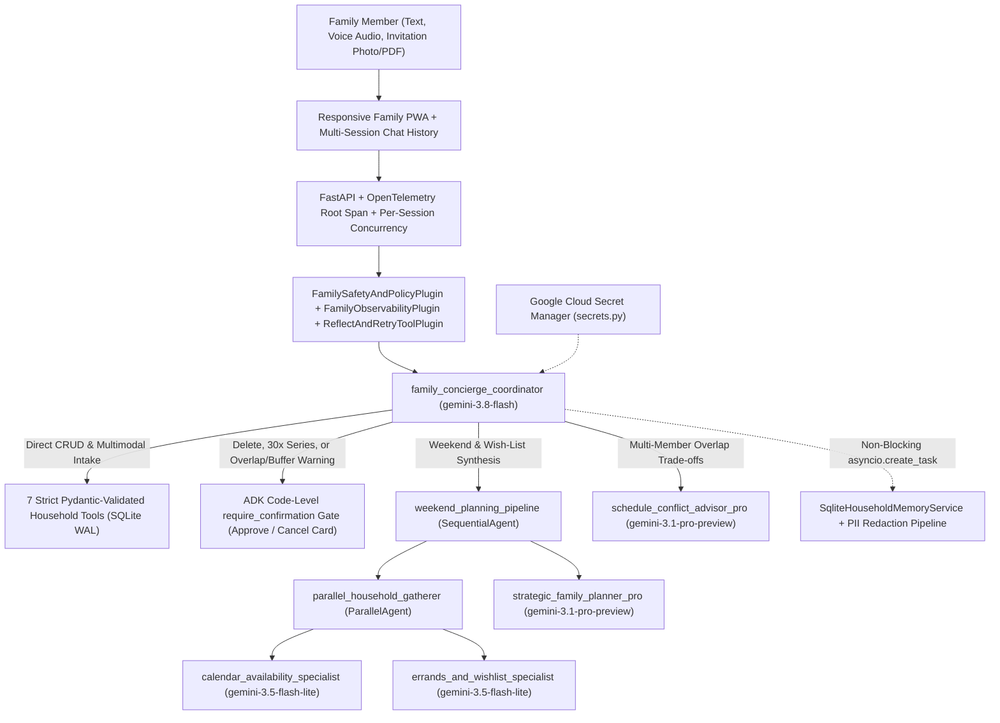

# Family Ops Concierge

**Family Ops Concierge** is a multimodal, multi-agent household planning application built with **Google Agent Development Kit (ADK)**, **FastAPI**, **OpenTelemetry**, **Google Cloud Secret Manager**, and **SQLite WAL**.

It helps busy families coordinate a shared **Family Calendar**, **Need-To-Do errands** (obligations with deadlines), and **Want-To-Do wish-list outings** (movies, exhibitions, and activities before they close) via **typed chat**, **spoken voice notes**, and **uploaded party invitations / school flyers**, while enforcing strict household scheduling rules, safety guardrails, and Human-in-the-Loop (HITL) approvals.

---

## Multi-Agent Architecture & Strategic Model Routing



### 3-Tier Strategic Model Routing (`family_concierge/model_router.py`)
- **Fast Parallel Lookup Tier (`gemini-3.5-flash-lite`)**: Powers concurrent `ParallelAgent` read-only specialists (`calendar_availability_specialist` + `errands_and_wishlist_specialist`), sliding-window `LlmEventSummarizer` history compaction, and background memory distillation.
- **Multimodal Coordinator Tier (`gemini-3.8-flash`)**: Powers `family_concierge_coordinator` for low-latency multimodal audio/image extraction, direct calendar/list CRUD, and sub-agent orchestration.
- **Deep Strategic Planning Tier (`gemini-3.1-pro-preview`)**: Powers `strategic_family_planner_pro` and `schedule_conflict_advisor_pro` for multi-member schedule synthesis, 30-minute sports/music arrival-buffer math, and conflict resolution.

---

## Household Domain Rules Enforced in Code & Prompt Constitution

1. **Mandatory Bracketed Participant Prefix**: Every event title is formatted as `[Member] Title`, `[Papa, Mama] Title`, or `[All] Title`. Ambiguous participant inputs return a structured `PARTICIPANTS_UNCLEAR` guided recovery hint instead of guessing `[All]`.
2. **Non-Fabricated Locations**: Event venues are stored only when stated by the user or printed on an invitation flyer; placeholder tokens (`TBD`, `Unknown`, `N/A`) are automatically stripped.
3. **Recurring Events (30 Repetitions)**: Repeating schedules (`DAILY`, `WEEKLY`, `BIWEEKLY`, `MONTHLY`) atomically generate `30` linked occurrences sharing a `series_id`, supporting single-occurrence or full-series cancellation.
4. **Non-Blocking Overlap & 30-Minute Arrival-Buffer Warnings**: `sports` and `music` events automatically prepend the household's configurable arrival buffer (`30` minutes by default). Because parallel family activities happen naturally (e.g. one child's music rehearsal overlapping another child's medical appointment), neither direct overlaps nor 30-minute buffer overlaps block event creation - instead, the Concierge and Calendar UI warn the user and request human confirmation (`require_confirmation` HITL card or `allow_overlap=True`) before saving.
5. **Live Timezone-Aware Clock**: `family_concierge/time_context.py` dynamically injects today's exact local date, time, and a 14-day weekday lookup table into every agent on every turn.

---

## AgentOps Code Review Matrix Mapping (19 Criteria)

| Category | Criterion | Implementation in Repository |
| :--- | :--- | :--- |
| **1. Tool & Interface Design** | Comprehensive Tool Docstrings | Google-style docstrings with purpose, `Args`, and `Returns` on all 7 tools in `family_concierge/tools.py` |
| | Descriptive Naming | Action-specific tool names (`schedule_family_calendar_event`, `delete_family_calendar_event`, `upsert_family_action_item`, etc.) |
| | Explicit JSON Schemas | Strict `ConfigDict(extra="forbid")` Pydantic input & output schemas (`TOOL_INPUT_OUTPUT_JSON_SCHEMAS`) + ADK `FUNCTION_TOOL_ARG_VALIDATION` |
| | Guided Error Handling | `GuidedToolErrorOutput` returning `error_code`, `message`, and actionable `recovery_hint` on validation or overlap conflicts |
| **2. Context & Memory** | Robust System Instructions | Structured XML `<constitution>` in `family_concierge/agent.py` covering persona, multimodal rules, domain policies, and safety |
| | History Compaction | ADK `App` configured with `EventsCompactionConfig` (`LlmEventSummarizer`) + `ContextCacheConfig` in `family_concierge/agent.py` |
| | Persistent Session State | Async SQLAlchemy `DatabaseSessionService` (`sqlite+aiosqlite`) + SQLite WAL store (`family_concierge/store.py`) + Multi-Session Chat History |
| | Async Memory Operations | Non-blocking `schedule_async_memory_consolidation` (`asyncio.create_task` + `asyncio.to_thread`) & `SqliteHouseholdMemoryService` (`family_concierge/memory_ops.py`) |
| **3. Orchestration & Logic** | Multi-Agent Patterns | Coordinator + `ParallelAgent` (`parallel_household_gatherer`) + `SequentialAgent` (`weekend_planning_pipeline`) in `family_concierge/sub_agents.py` |
| | Strategic Model Routing | 3-tier `TaskComplexityTier` router (`Flash-Lite`, `Flash`, `Pro`) with HTTP retry/timeout resilience in `family_concierge/model_router.py` |
| | Guardrails & Policy Plugins | `FamilySafetyAndPolicyPlugin(BasePlugin)` + `SelfEvalVerdict` output compliance + ADK `ReflectAndRetryToolPlugin` (`family_concierge/guardrails.py`) |
| | Human-in-the-Loop Hooks | Code-level ADK `require_confirmation=True` + `ResumabilityConfig(is_resumable=True)` + interactive Web UI Approval Card (`/api/chat/confirm`) |
| **4. Observability & Tracing** | Structured JSON Logging | `python-json-logger` (`JsonFormatter`) Cloud Logging-compatible JSON telemetry in `family_concierge/observability.py` |
| | Intent vs. Outcome Capture | `FamilyObservabilityPlugin` emitting paired `phase="INTENT"` and `phase="OUTCOME"` JSON records with matching `correlation_id` |
| | Distributed Tracing | OpenTelemetry `TracerProvider` linking `concierge.chat_request` -> `adk.run` -> `adk.agent` -> `adk.llm` / `adk.tool` spans (`GET /api/telemetry`) |
| | PII Redaction | `PiiRedactionPipeline` (deterministic scrubber + Google Cloud DLP `dlp_v2` adapter) scrubbing both logs and SQLite memories (`family_concierge/pii_redactor.py`) |
| **5. Infrastructure & CI/CD** | Automated Evaluation Suites | ADK golden evalset (`evals/golden_dataset.evalset.json` + `evals/test_config.json`) + `pytest` suite (`tests/`) + GitHub Actions CI |
| | Infrastructure as Code | `terraform/` HCL (`main.tf`, `variables.tf`, `outputs.tf`), `Dockerfile`, and ADK Agent CLI workflows below |
| | Secure Secret Management | `family_concierge/secrets.py` (`google-cloud-secret-manager` with caching + git-ignored `.env` local dev fallback, zero hardcoded keys) |

---

## Quickstart & Local Development

```bash
# 1. Create and activate virtual environment
python3 -m venv .venv
source .venv/bin/activate
pip install -r requirements.txt

# 2. Configure local environment credentials (never committed to Git)
cp .env.example family_concierge/.env
# Edit family_concierge/.env and set GOOGLE_API_KEY=<your-key> (or USE_SECRET_MANAGER=1 with GOOGLE_CLOUD_PROJECT)

# 3. Launch the full Family Ops Concierge PWA + FastAPI + ADK server
uvicorn app.server:app --host 0.0.0.0 --port 8080 --reload
```

Open `http://localhost:8080` in your browser. Fresh databases automatically load the synthetic **Foobar Family** fixture (`family_concierge/seed_data.json`; set `FAMILY_OPS_SKIP_SEED=1` to start empty).

---

## Google ADK / Agent CLI Usage

Because `family_concierge` exports both `app` (`google.adk.apps.App`) and `root_agent`, it works natively with all **Google ADK CLI (`adk`)** developer, evaluation, and deployment commands:

```bash
# Activate your virtual environment first
source .venv/bin/activate

# 1. Launch the interactive ADK Dev UI to inspect sub-agent graphs, state, and HITL events
adk web --host 0.0.0.0 --port 8000 --reload_agents .

# 2. Run an interactive terminal chat session directly with the Coordinator agent
adk run family_concierge

# 3. Serve the headless ADK REST/SSE API server
adk api_server --host 0.0.0.0 --port 8001 .

# 4. Execute the Golden Evaluation Suite via the ADK CLI evaluator
adk eval family_concierge evals/golden_dataset.evalset.json \
  --config_file_path evals/test_config.json \
  --print_detailed_results

# 5. Deploy the ADK agent directly to Google Cloud Run via Agent CLI
adk deploy cloud_run \
  --project "$GOOGLE_CLOUD_PROJECT" \
  --region us-central1 \
  --service_name family-ops-concierge-adk \
  --with_ui \
  ./family_concierge
```

---

## Running Automated Tests & Evaluations (`pytest`)

```bash
# Run the fast deterministic AgentOps unit & schema regression suite (no API key required)
pytest tests/test_agentops_unit_suite.py -v

# Run the full suite including live Gemini golden trajectories & HITL pause/resume tests
pytest -v
```

---

## Provisioning Cloud Infrastructure with Terraform (`terraform/`)

The `terraform/` directory programmatically provisions Artifact Registry, a least-privilege IAM runtime Service Account, Google Cloud Secret Manager (`family-ops-gemini-api-key`), Cloud DLP / Trace / Logging permissions, and a Cloud Run v2 service:

```bash
# 1. Build and push the container image to Artifact Registry
export PROJECT_ID="your-gcp-project-id"
export REGION="us-central1"
gcloud builds submit --tag "${REGION}-docker.pkg.dev/${PROJECT_ID}/family-ops-agents/family-ops-concierge:latest" .

# 2. Add your Gemini API key version to Secret Manager (after secret creation or pre-seed)
# printf "%s" "$GOOGLE_API_KEY" | gcloud secrets versions add family-ops-gemini-api-key --data-file=-

# 3. Initialize, validate, and apply Terraform Infrastructure as Code
cd terraform
cp terraform.tfvars.example terraform.tfvars
# Edit terraform.tfvars with your project_id and container_image
terraform init
terraform validate
terraform plan
terraform apply
```
